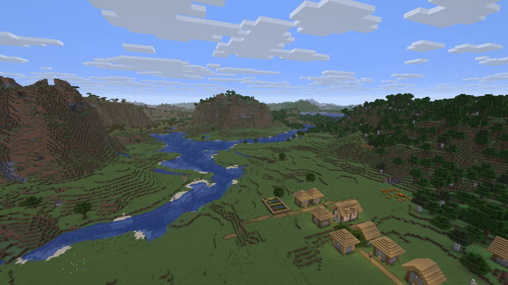
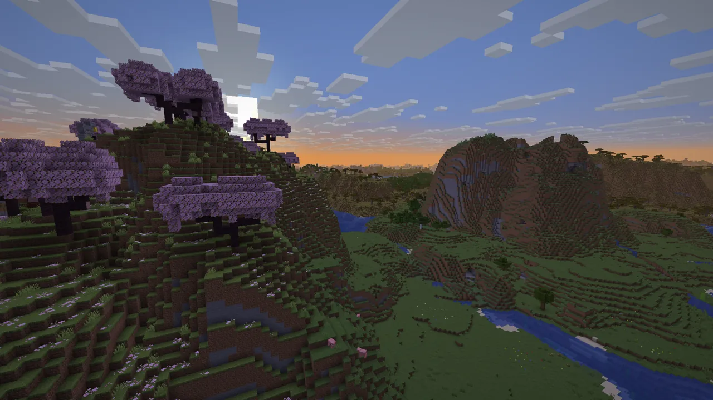
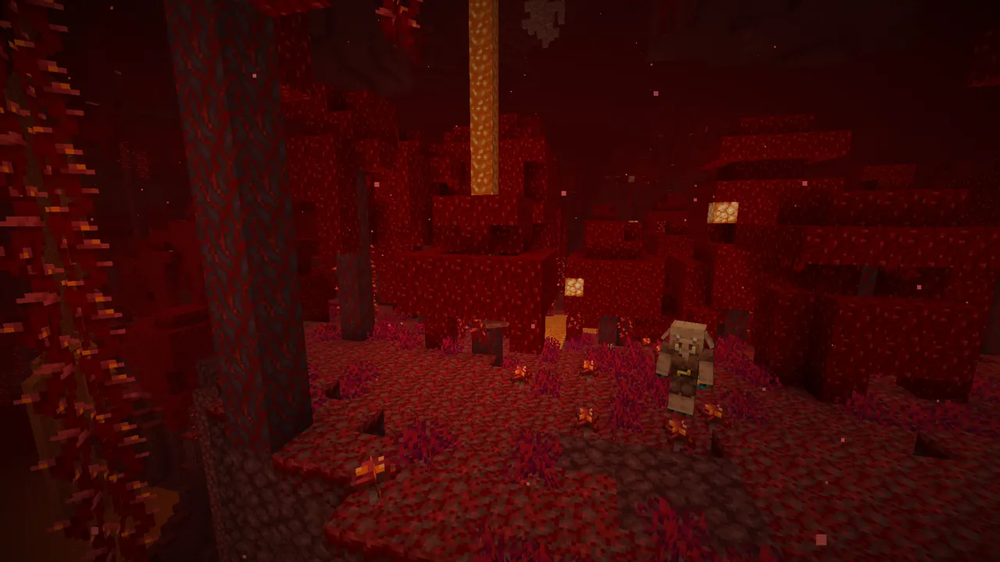
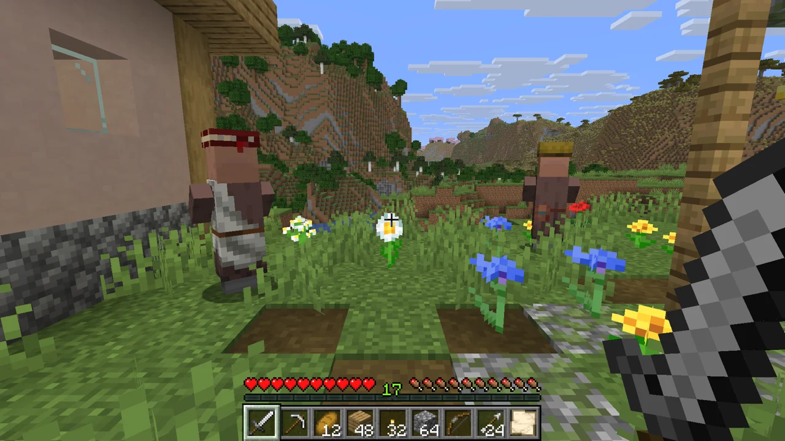
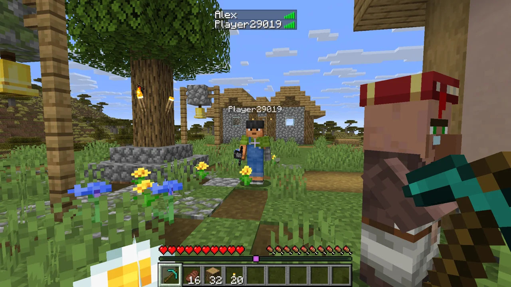
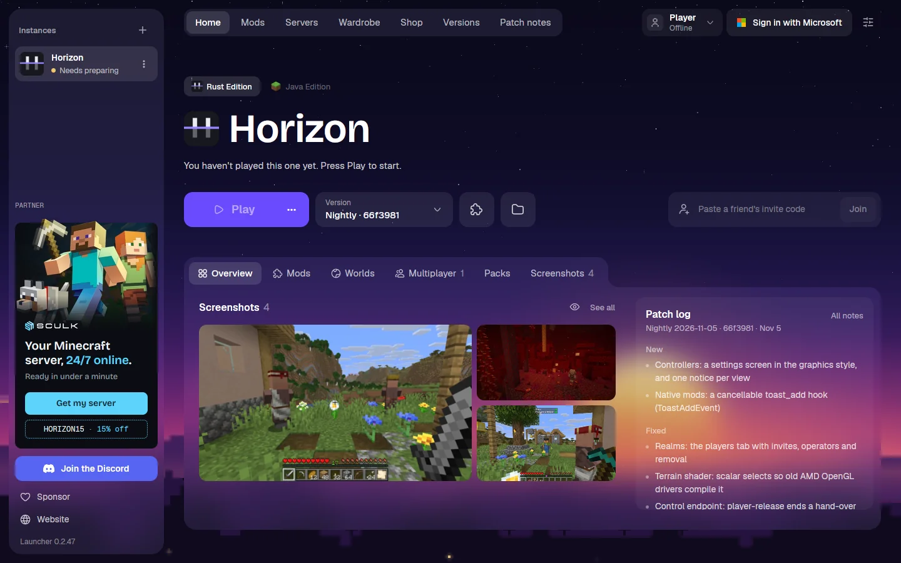
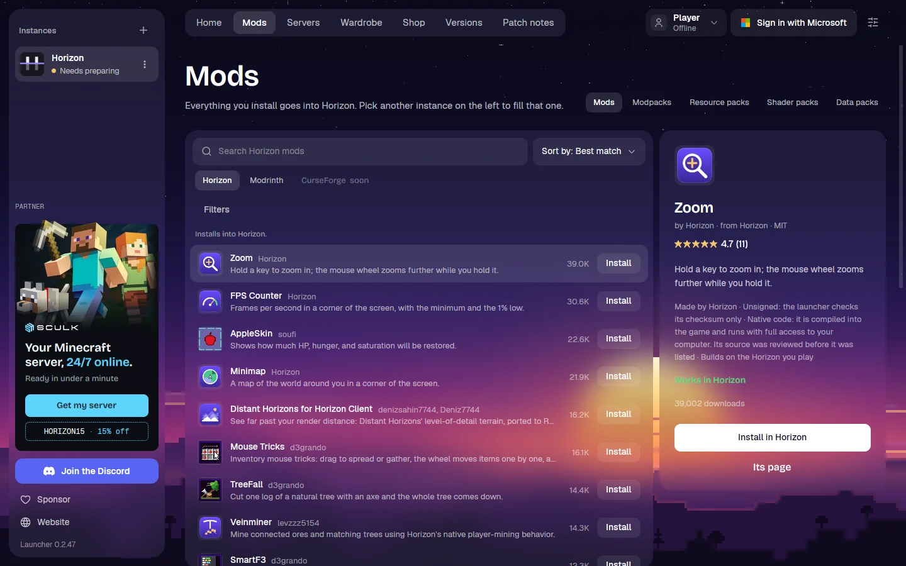

<p align="center">
<<<<<<< HEAD
  
  
  <a href="https://github.com/ludovic111/horizon"></a>
  
  <a href="LICENSE"></a>
||||||| 31f83499b6
  
</p>

<p align="center">
  <a href="https://github.com/horizon-rust/horizon/actions/workflows/ci.yml"></a>
  
  
  
  <a href="#project-status"></a>
  
  <a href="LICENSE"></a>
=======
  
>>>>>>> c98a51a664
</p>

<p align="center">
  <a href="#download"><b>Download</b></a> ·
<<<<<<< HEAD
  <a href="#android-status"><b>Android status</b></a> ·
  <a href="roadmap/starling.md"><b>Roadmap</b></a> ·
  <a href="#mods"><b>Mods</b></a> ·
  <a href="#build-from-source"><b>Build from source</b></a> ·
  <a href="CONTRIBUTING.md"><b>Contributing</b></a> ·
  <a href="https://github.com/ludovic111/horizon"><b>Horizon</b></a>
||||||| 31f83499b6
  <a href="https://playhorizon.dev/docs/"><b>Documentation</b></a> ·
  <a href="https://github.com/horizon-rust/horizon/releases"><b>Release notes</b></a> ·
  <a href="ROADMAP.md"><b>Roadmap</b></a> ·
  <a href="#project-status"><b>Project status</b></a> ·
  <a href="#contributing"><b>Contributing</b></a>
=======
  <a href="https://playhorizon.dev/docs/"><b>Docs</b></a> ·
  <a href="https://discord.gg/playhorizon"><b>Discord</b></a> ·
  <a href="ROADMAP.md"><b>Roadmap</b></a> ·
  <a href="#contributing"><b>Contributing</b></a>
>>>>>>> c98a51a664
</p>

<<<<<<< HEAD
# Starling
||||||| 31f83499b6
# Horizon
=======
<p align="center">
  
  <a href="#project-status"></a>
</p>

# Horizon
>>>>>>> c98a51a664

<<<<<<< HEAD
**Starling is a lightweight port of Minecraft: Java Edition 26.3 to Android.** It is a fork of [Horizon](https://github.com/ludovic111/horizon), the Java game rewritten in Rust: it reads the same worlds, follows the same rules and generates the same terrain as Java Edition, and is checked against it by differential harnesses. You play it on the files from your own copy of Minecraft; it is free, open source and unofficial. And it runs natively, with no Java virtual machine and no OpenGL translation in between, so it starts fast and plays smoothly on a phone.
||||||| 31f83499b6
Minecraft: Java Edition 26.3, rewritten in Rust. Same worlds, same rules, same terrain, checked against the Java game by more than 300 differential harnesses. Free, open source and unofficial.
=======
**Minecraft: Java Edition 26.3, rewritten in Rust.** Your worlds, the same rules and the same terrain as the Java game, checked against it by hundreds of differential tests, in one native program with no Java. Free, open source (MIT) and unofficial: you play it with your own copy of Java Edition.
>>>>>>> c98a51a664

<<<<<<< HEAD
> Not an official Minecraft product. Not approved by or associated with Mojang or Microsoft. Starling contains no Minecraft code, assets or data: you need your own legally obtained copy of Minecraft: Java Edition 26.3.

## Download

**[Starling v0.2.3](https://github.com/JuanLuci/starling/releases/latest)**. Already have Starling? Tap **Update** inside the game. New here? Download `starling-0.2.3-arm64-v8a.apk` from [the releases page](https://github.com/JuanLuci/starling/releases) and open it on the phone (Android asks you to allow installing apps from your browser or file manager).

**You need** a 64-bit phone with Android 8 or newer and Vulkan, and about 2 GB free. Sign in with a Microsoft account that owns Minecraft: Java Edition, or play offline (most servers need the sign-in). No computer: on the first start Starling downloads the game's files from Mojang's servers and prepares them on the phone, once (79 seconds on a POCO F6 Pro, longer on slower phones). Go fishing or change the settings while it works.

Development happens in [starling-client/starling](https://github.com/starling-client/starling), on the `starling` branch, where Starling and Horizon Android are becoming one app. Builds of every push there are **Starling Preview**, in [GitHub Actions](https://github.com/starling-client/starling/actions/workflows/android.yml) (the `starling-apk` artifact of a run; GitHub asks you to sign in to download it): an app of its own, installed beside the release, with its own `StarlingPreview` folder and sign-in. You can also [build it from source](#build-from-source).
||||||| 31f83499b6
> Not an official Minecraft product, nor approved by or associated with Mojang or Microsoft. Horizon contains no Minecraft code, assets or data: you need your own copy of Java Edition 26.3.

## Download

Get **the Horizon launcher** from [playhorizon.dev](https://playhorizon.dev) or [the launcher releases](https://github.com/horizon-rust/horizon/releases?q=launcher-v&expanded=true) (Linux x86-64, macOS on Apple Silicon, macOS on Intel from the next Nightly, Windows x64). It installs and updates the game, prepares its files from your copy of Minecraft, and updates itself.

**You need** a Microsoft account that owns Java Edition ([why](docs/microsoft-account.md)) and a GPU with Vulkan or OpenGL 3.3 (Linux), Vulkan or DirectX 12 (Windows), or a Mac (Apple Silicon, or Intel from the next Nightly). An existing Minecraft install (official launcher, Prism, MultiMC...) is reused; without one, Play downloads 26.3 from Mojang for your account. Step by step: [Install and first launch](https://playhorizon.dev/docs/install).

<table>
  <tr>
    <td width="50%"></td>
    <td width="50%"></td>
  </tr>
</table>
=======
<p align="center">
  
</p>
>>>>>>> c98a51a664

## What works today

<<<<<<< HEAD
- **Setting up on the phone:** sign in with your Microsoft account, and the game's files come from Mojang and are prepared on the phone, by a Java runtime fetched just for that and removed after, with every language the game has. While it works, fish in a little pond, or change the settings in a hand-drawn skin made for this screen (the game's own look is part of what is being prepared). Resources prepared on a computer still open too.
- **The game:** singleplayer with vanilla's world generation, mobs, villagers, raids, redstone, every command, the HUD and the recipe book, on saves in vanilla's format, saved as soon as the app leaves the screen. Worlds from 1.8 to 26.2 are upgraded as vanilla does. Starling follows Horizon closely: v0.2.0 has its main of 2026-11-02.
- **Touch controls:** every action on screen, from the movement stick to the hotbar, chat, commands and F3, with a layout you can move, resize and fade in the game, before a world too, and Sneak as Hold or Toggle. Bedrock's control modes: a stick (floating or fixed) or a D-pad, and tap to interact (a tap hits the mob or uses the block under the finger, a press breaks the block, interacts with the mob or uses the item in the air) or aim crosshair. F3 held offers its combinations (chunk borders, hitboxes, tooltips...); Pick Block and the player list are buttons to turn on; the phone buzzes when a block breaks or a stack splits, and it can aim by turning (gyroscope, off by default). They wear Bedrock's own buttons, fetched on the phone from Mojang's samples repository after the preparing (Starling ships none of them, only their names and hashes), else Starling's own.
- **Custom buttons:** tap **Add** in **Touch Controls**, or go to **Options > Controls > Custom Buttons**. Each one holds or toggles a key, a native mod's too, or sends a command or a chat line, and wears an icon or your own image, drawn on Bedrock's plate or imported as a PNG, with another for while it is pressed.
- **Bedrock Inventory:** the creative inventory shows the items and your inventory side by side, with six rows of items and a 2x2 crafting grid, and a tap takes a full stack. It is on by default; turn it off in **Options > Controls** for the Java layout.
- **Your name and your skin:** in Options > Skin Customization, the name your worlds use and a skin from your files (or `Starling/skins`), classic or slim; a skin PNG opened with Starling is put on at once.
- **The phone's own keyboard:** a tap on a text field brings it up and a tap beside it puts it away, on every screen. Its suggestions, autocorrect, swipe typing and clipboard in the chat, signs and books (commands and searches go without autocorrect), a Paste button on the chat bar, and Enter finishing a command when only one completion fits (`/gamemode c` runs `/gamemode creative`).
- **Coming from Horizon Android:** Starling offers to bring its worlds and resource packs over, in the setup or over the title screen, and copies them: Horizon Android keeps its own.
- **Your files within reach:** worlds, resource packs, shader packs, mods and screenshots live in a `Starling` folder on the phone's storage, which any file manager opens (turned down on the first start, it is offered again by the Open Pack Folder buttons). Open a `.starling`, `.hmod` or `.hnmod` file with Starling to add a pack, a world or a mod.
- **Made for phones:** settings picked for your device on the first start, and a stats overlay for FPS, memory and temperature.
- **Horizon's own extras:** new menus (vanilla's are one setting away), graphics presets and more, all off by default where they would change the vanilla look. See [Settings](https://playhorizon.dev/docs/settings).
- **Resource packs and data packs:** resource packs work, and data packs load functions, predicates and item modifiers.
- **Servers:** offline-mode servers, behind a proxy such as Velocity too, with their resource packs, coloured chat, boss bars, signs, workstation menus (enchanting, anvil, smithing...), flight and the attributes they set. Plugin servers' dialogs, chat buttons, custom armour (ItemsAdder, Nexo), models riding their mobs (ModelEngine, BetterModel) and clickable furniture work, and the touch stick moves in a way each server's anticheat (GrimAC and the like) accepts: Free Direction, D-pad or Analog, remembered per server.
- **Shader packs:** Iris and OptiFine packs such as Complementary, MakeUp, BSL, Photon and Bliss run on the phone, translated when they load: put them in `Starling/shaderpacks` and pick one in **Video Settings > Shader Packs**, where the **Auto** profile fits it to the phone, beside **Shader Options**, **Resolution** and **FPS Limit**. On Auto on a Snapdragon 8 Gen 2: MakeUp 87 fps, Complementary Reimagined 59, BSL 54, Complementary Unbound 39, Photon 27 to 39. See the [roadmap](roadmap/starling.md).
- **Starling Visuals:** Starling's own shader pack, made for phones, which comes with the app: pick it in **Video Settings > Shader Packs** ([packaging/shaderpacks/starling-visuals](packaging/shaderpacks/starling-visuals), also `StarlingVisuals.zip` on the releases page). Sunlight and shadows, water with waves and depth, haze thicker down low and at dawn, sun rays through the trees and clouds, bloom, and light from a torch in your hand.
- **Mods:** Horizon's native mods (`.hnmod`), compiled from the phone itself, and content mods (`.hmod`). See [Mods](#mods).
||||||| 31f83499b6
- **The game:** vanilla world generation, mobs, villagers, raids, redstone, every command, the HUD and the recipe book, on vanilla saves. Worlds from 1.8 to 26.2 are upgraded. [Status](#project-status).
- **Extras:** new menus, graphics presets, distant terrain up to 1024 chunks, controllers, zoom, minimap and more, off by default where they change the vanilla look. [Settings](https://playhorizon.dev/docs/settings).
- **Packs:** resource packs, and data packs with functions, predicates, item modifiers and world generation.
- **Multiplayer:** invite friends with a code, Open to LAN, join servers (online mode included). [Multiplayer](https://playhorizon.dev/docs/multiplayer).
- **Mods:** content mods (blocks, items, data) and native Rust mods, built by the launcher with nothing to install. Java mod jars do not run. [Mods](https://playhorizon.dev/docs/mods).
=======
Everything below is in the current release.
>>>>>>> c98a51a664

<<<<<<< HEAD
## Android status
||||||| 31f83499b6
In the Rust client, with vanilla assets and no mods or shaders:
=======
- **The game.** Survival, creative, hardcore and spectator; vanilla world generation in all three dimensions, mobs, villagers, raids, redstone, every command, the HUD and the recipe book. Vanilla saves open as they are, and worlds from 1.8 to 26.2 are upgraded.
- **Multiplayer.** Join vanilla and Horizon servers (online mode included), open a world to LAN, or invite friends with a code from the launcher's Home page.
- **Graphics.** Distant terrain up to 1,024 chunks, graphics presets, HDR and controllers, all off by default where they would change the vanilla look ([settings](https://playhorizon.dev/docs/settings)).
- **Packs.** Resource packs, data packs and shader packs ([below](#mods-and-shader-packs)).
- **Mods.** Content mods and native Rust mods, installed from the launcher ([below](#mods-and-shader-packs)).
- **Servers.** Host one from the launcher, or run `horizon-server` on a VPS ([below](#host-a-server)).
- **The launcher.** It installs and updates the game, prepares its files from your copy of Minecraft, and updates itself.
>>>>>>> c98a51a664

<<<<<<< HEAD
What the Android port covers so far; what is being done now and next is in the [roadmap](roadmap/starling.md). The game itself is Horizon's: its parity audit, measured on the desktop, is in [Horizon's project status](https://github.com/ludovic111/horizon#project-status) ([as of Starling's base](docs/horizon-parity.md)).
||||||| 31f83499b6
<table>
  <tr>
    <td colspan="2"></td>
  </tr>
  <tr>
    <td width="50%"></td>
    <td width="50%"></td>
  </tr>
  <tr>
    <td width="50%"></td>
    <td width="50%"></td>
  </tr>
</table>
=======
<table>
  <tr>
    <td width="50%"></td>
    <td width="50%"></td>
  </tr>
  <tr>
    <td width="50%"></td>
    <td width="50%"></td>
  </tr>
</table>
>>>>>>> c98a51a664

<<<<<<< HEAD
| Part | Progress | Notes |
| --- | --- | --- |
| The game, singleplayer |  | Horizon's game, as on the desktop |
| Touch controls |  | Every action, with an editable layout and buttons of your own; a stick, a D-pad or Free Direction on servers; Bedrock's buttons, fetched from Mojang |
| Starling folder, `.starling`, `.hmod` and `.hnmod` files |  | Packs, worlds, mods and game files, opened with Starling |
| Resource packs |  | Server packs too, loaded without freezing the game |
| Performance tuning |  | Settings picked per phone, resolution down to 25% for weaker ones; mid-range phones not measured yet |
| Settings |  | Options that do nothing are greyed out, those a phone can't use are hidden |
| Mods |  | Native mods compiled from the phone, tried end to end with test mods; content mods; a run over the registry's mods still to do |
| Servers |  | Offline-mode servers and proxies, dialogs, chat buttons and links, secure chat with a signed-in account |
| Server plugins |  | Custom armour from any pack, animated models riding mobs, block and item displays, clickable furniture, item cooldowns, HUD text without shadows |
| Movement on anticheat servers |  | Free Direction, D-pad or Analog per server, no pull-backs on GrimAC or Pika in tests; breaking blocks as vanilla predicts them (a dig before the move into its space); some old-version servers behind ViaVersion still pull back |
| Shader packs |  | Complementary, MakeUp, BSL, Photon and Bliss run on a phone, with an Auto profile and Shader Options; some effects still differ |
| APK builds and updates |  | Signed releases on the releases page, offered and installed by the game itself from v0.1.0.1 (the first offered: v0.1.1); every push also builds an APK in GitHub Actions |
| Open to LAN and invites |  | Horizon's, in the game; little tried on a phone so far |
| Physical controllers |  | Android's gamepads, tried on a phone |
| Setting up on the phone |  | Prepared on a phone in 79 s from the official 26.3 files, with Java fetched for it; fishing and hand-drawn settings while it works |
| Microsoft account sign-in |  | On the first start and in the game (the title screen's corner); the code and the ownership check work on a phone |
||||||| 31f83499b6
## Host a server
=======
<sub>Nightly 2026-11-05 on a Mac mini (Apple M4 Pro, Metal): vanilla's textures, no mods or shader packs, render distance 32 with distant terrain on.</sub>

## Performance

**Horizon draws more frames per second than Java Edition, and loads faster, on the same machine, world and path.** `tools/perf_bench.py` runs each game in turn, from a fresh world (seed 1234), waiting for the terrain and then flying it over a village, a forest, an ocean and a mountain. Measured on 2026-10-29/30 on an idle Windows 11 machine (Ryzen 7 9800X3D, RTX 5080), Horizon v0.2.97 as the launcher installs it, 1280x720 in a window, VSync off, three games per figure. Frames per second, mean of the four scenes, with the slowest 1% of frames in brackets:

| Render distance | Horizon v0.2.97 | Vanilla 26.3 | Vanilla + mods |
| --- | --- | --- | --- |
| 8 chunks | 3,289 (1,327) | 2,437 (640) | 2,375 (709) |
| 16 chunks | 2,074 (598) | 1,661 (375) | 1,586 (432) |
| 32 chunks | 1,207 (333) | 1,031 (176) | 879 (264) |

"Vanilla + mods" is Sodium, Lithium, FerriteCore and ImmediatelyFast. Horizon reaches the title screen in 2.9–3.2 s against vanilla's 7.5–7.7 s (the modded client's 10.8–11.1 s), loads a scene's chunks 2.9–3.8 times faster, and playing holds a steady working set of 1.1–1.7 GB against 1.9–2.9 GB. Every scene with its confidence interval and the run's load log: [the 2026-10-29 reports](benchmarks/perf/windows-9800x3d-5080-2026-10-29.md). Method, and how to measure your own machine: [docs/benchmark.md](docs/benchmark.md). [playhorizon.dev/benchmarks](https://playhorizon.dev/benchmarks) puts these runs beside a 2016 laptop, a Mac mini and a gaming desktop.

## Download

Get **the Horizon launcher** from [playhorizon.dev](https://playhorizon.dev), or from [the launcher releases](https://github.com/horizon-rust/horizon/releases?q=launcher&expanded=true):

| Platform | File | Needs |
| --- | --- | --- |
| Windows x64 | `horizon-launcher-setup.exe` | Windows 10 or 11, a GPU with Vulkan or DirectX 12 |
| Windows on Arm | `horizon-launcher-setup-arm64.exe` | Windows 11 on Arm |
| macOS, Apple Silicon | `horizon-launcher-macos-arm64.dmg` | macOS 12 or later |
| macOS, Intel | `horizon-launcher-macos-x64.dmg` | macOS 12 or later |
| Linux x86-64 | `horizon-launcher-linux-x86_64.AppImage` or `.tar.gz` | a glibc distribution, X11 or Wayland, a GPU with Vulkan or OpenGL 3.3 |

**You also need a Microsoft account that owns Minecraft: Java Edition.** You sign in with it in the launcher, which plays only with an account that owns the game ([why](docs/microsoft-account.md)). Horizon contains no Minecraft code or assets: an existing install (official launcher, Prism, MultiMC...) is reused, and without one the launcher downloads 26.3 from Mojang for your account. Step by step: [Install and first launch](https://playhorizon.dev/docs/install).

<table>
  <tr>
    <td width="50%"></td>
    <td width="50%"></td>
  </tr>
</table>

## Mods and shader packs

- **Content mods** (`.hmod`): blocks, items, recipes, loot, models and textures, with no code.
- **Native mods** (`.hnmod`): Rust that the launcher compiles into the game for you, with nothing to install.
- **Java mods** (Fabric, NeoForge, Forge) don't run: Horizon has no Java. The launcher carries over the data and assets inside their jars, and imports modpacks (`.mrpack`, CurseForge zips, Prism instances) the same way ([modpacks](https://playhorizon.dev/docs/modpacks)).
- **Shader packs**: Iris/OptiFine-format packs (`shaders/` folders) and Horizon's own WGSL packs, under Video Settings → Shader Packs ([pack format](docs/shaders.md)).

Mods are off by default: a fresh install plays exactly like vanilla 26.3. The launcher's Mods page browses Horizon's registry and Modrinth. [Mods](https://playhorizon.dev/docs/mods) · [make a mod](docs/mods.md).

## Host a server
>>>>>>> c98a51a664

<<<<<<< HEAD
Local crash reports, Android exit history and optional CPU/GPU performance
recordings are available under **Options → Diagnostics**. Export a diagnostic ZIP,
review it, then share it with a bug report. See [Android diagnostics](docs/android-diagnostics.md)
for contents, limits and controls. Before installation or after an early startup
failure, Diagnostics also opens in a separate window; long-press the app icon to
reach it without starting the game.

## Mods

Starling runs Horizon's mods. Open the file with Starling, from your file manager or your downloads, and it shows up in **Options > Mods**.
||||||| 31f83499b6
The launcher's **Servers** page creates, starts, backs up and updates a server, and invites friends over Tailscale. On a VPS, `horizon-server` installs with one command and needs no Java. [Host a server](https://playhorizon.dev/docs/hosting) ([reference](docs/hosting.md)).

## Modpacks

The launcher imports Modrinth and CurseForge packs and plays the mods Horizon can carry over: today, content mods made of data and assets, not Java code. [Modpacks](https://playhorizon.dev/docs/modpacks).
=======
The launcher's **Servers** page creates, starts, backs up and updates a server, and invites friends. On a VPS, `horizon-server` installs with one command, needs no Java, and takes vanilla 26.3 and Horizon players alike. [Host a server](https://playhorizon.dev/docs/hosting) ([reference](docs/hosting.md)).
>>>>>>> c98a51a664

- **`.hnmod`, native mods:** tap **Compile**. Starling tells you the risks, builds the game with your mods while you fish or mine, and restarts with them. It takes a few minutes and needs a connection, and after an update you compile again. A native mod runs as part of the game, so install only the ones you trust. See [native mods](docs/native-mods.md) and [how Starling builds them](docs/starling-native-mods.md); [wrench](native-mods/wrench) is an example.
- **`.hmod`, content mods:** data-only mods, with nothing to compile. See [mods](docs/mods.md).

<<<<<<< HEAD
The old Starling mods and the WebAssembly mod format of v0.1 are gone.
||||||| 31f83499b6
AI agents and scripts can play Horizon. `horizon-ctl`, shipped with the game, reads its state as JSON and acts like a player; `horizon-ctl mcp` serves the same commands over MCP.

```sh
horizon-ctl launch --world Survival --seed 5 --wait   # finds the version the launcher installed
horizon-ctl state                                       # position, health, food, target, screen...
horizon-ctl find-block birch_log                        # the nearest logs
horizon-ctl goto -0.5 65 -2.5 --near 2.5                # walks there along a path
horizon-ctl break -1 65 -3                              # mines it; replies with the drops
horizon-ctl open-inventory && horizon-ctl click-slot 0  # menus: slots, buttons by label, text fields
```

Commands block until done and reply with the result; `horizon-ctl help` lists them all. [Agent control](docs/native-client.md#agent-control-horizon-ctl-and-mcp).
=======
AI agents and scripts can play Horizon. `horizon-ctl`, shipped with the game, reads its state as JSON and acts like a player; `horizon-ctl mcp` serves the same commands over MCP.

```sh
horizon-ctl launch --world Survival --seed 5 --wait   # finds the version the launcher installed
horizon-ctl state                                       # position, health, food, target, screen...
horizon-ctl goto -0.5 65 -2.5 --near 2.5                # walks there along a path
horizon-ctl break -1 65 -3                              # mines it; replies with the drops
```

`horizon-ctl help` lists every command. [Agent control](docs/native-client.md#agent-control-horizon-ctl-and-mcp).
>>>>>>> c98a51a664

## Build from source

For developers. Requirements: Rust 1.90 or newer with the `aarch64-linux-android` target, [cargo-ndk](https://github.com/bbqsrc/cargo-ndk), the Android SDK (build-tools 35.0.0, platform 36, NDK r28c), a JDK 25 and Python 3.10 or newer.

```sh
git clone -b starling https://github.com/starling-client/starling.git
cd starling
python packaging/android/build_apk.py            # the APK lands in target/android/
```

The setup's hand-drawn skin is made by `python packaging/lowbudget/make.py` (with Pillow) into `packaging/lowbudget/pack`, which the APK carries as it is.

<<<<<<< HEAD
The APK contains no game files. On the phone, Starling downloads them from Mojang's servers and prepares them there. To prepare them on a computer instead, it builds its resources from **your own copy** of Minecraft: Java Edition 26.3, verified against the checksums in `research-lock.json`, the same way Horizon does:

1. **Client:** install Java Edition with the official launcher and play 26.3 once. Horizon reads `versions/26.3/`, `libraries/` and `assets/` from the launcher's game directory. If yours lives elsewhere, pass `--minecraft-dir` or set `HORIZON_MINECRAFT_DIR`.
2. **Server jar:** the 26.3 server jar, from the `downloads.server.url` in your launcher's `versions/26.3/26.3.json`. Pass it with `--server-jar` or set `HORIZON_SERVER_JAR`.

```sh
cargo run --release -p horizon-prepare -- --prepare --server-jar ~/Downloads/server.jar   # needs JDK 25
```

The prepared files land in the gitignored `.local/horizon-client/26.3`. Zip that folder, rename the zip to `.starling` and open it with Starling. It is derived from the game: never commit it or share it.

||||||| 31f83499b6
## Roadmap

What is in progress, what comes next and where to help: [ROADMAP.md](ROADMAP.md), or [playhorizon.dev/hub](https://playhorizon.dev/hub) with the work board and what shipped.

=======
>>>>>>> c98a51a664
## Contributing

<<<<<<< HEAD
Issues and pull requests are welcome: see [CONTRIBUTING.md](CONTRIBUTING.md). Changes to the game itself belong upstream, in [Horizon](https://github.com/ludovic111/horizon); Starling is the Android app around it.
||||||| 31f83499b6
Issues and pull requests are welcome: read [CONTRIBUTING.md](CONTRIBUTING.md) (vanilla first, small pull requests). Questions: [Discord](https://discord.gg/playhorizon). Before a pull request, run the self-check and paste its output:

```sh
git config core.hooksPath .githooks
python3 tools/pr_ready.py
```

It runs rustfmt, clippy, the touched crates' tests, the Python tests, the public-tree check and the vanilla harnesses your change affects. Never commit game files, decompiled source or prepared resources.

## Project status

**Player-visible gaps: 833 open** of the 833 the [port ledger](tools/port_ledger.py) found, reading every vanilla 26.3 method against Horizon's code: vanilla behaviour a player would notice that Horizon doesn't have yet. By area: Screens, HUD and client packets [197](https://github.com/horizon-rust/horizon/issues/3518); Entity and block rendering, models [129](https://github.com/horizon-rust/horizon/issues/3519); Animals [110](https://github.com/horizon-rust/horizon/issues/3512); Server and players on the server [106](https://github.com/horizon-rust/horizon/issues/3520); Blocks, redstone and fluids [86](https://github.com/horizon-rust/horizon/issues/3516); Entities, projectiles, vehicles and decorations [64](https://github.com/horizon-rust/horizon/issues/3514); Monsters and bosses [53](https://github.com/horizon-rust/horizon/issues/3513); Mob AI, villagers and raids [35](https://github.com/horizon-rust/horizon/issues/3521); World, world generation and saves [32](https://github.com/horizon-rust/horizon/issues/3517); Items, enchantments and inventories [21](https://github.com/horizon-rust/horizon/issues/3515). This number goes down as gaps close (`tools/parity_gaps.py`); the harness results below say that what is tested matches.

The table is the project's own audit: every subsystem matches vanilla in every harness that compares it. 100% means 100% of what the harnesses compare, not that nothing else differs.

### Java parity: 100%

Scores: 0 (absent), 0.25 (started), 0.5 (playable, major features missing), 0.75 (mostly complete) or 1 (complete and verified by differential tests); the percentage is their average. Last audited 2026-10-13: all 281 harnesses pass on Linux and macOS. The [port ledger](tools/port_ledger.py) adds a method-by-method view of what is ported.

| Subsystem | Score | Main gaps |
| --- | ---: | --- |
| Window, input and game loop | 1 | None: game loop, options, camera, auto-jump, toggle sprint/sneak and frame limiter match |
| Assets and resources | 1 | None: item models match over 196,290 stacks; the resource pack screen over 3,000 sessions |
| Network protocol and multiplayer | 1 | None: joins vanilla servers; the dedicated server matches vanilla's files, login, configuration, play and command tree; LAN discovery over 462 cases (offline mode only) |
| Chunk storage and palettes | 1 | None: client and saves share paletted containers, identical to vanilla over 266 scenarios |
| Section meshing | 1 | None: 112 scenes and over a million quads identical to vanilla |
| Rendering | 1 | None: entity models, block entity renderers (407 cases) and animations (296), HUD overlays (2,200 states), the recipe book (600), player list, subtitles and world border match |
| Lighting | 1 | None: saved and relit light matches vanilla, slabs and stairs included |
| World generation | 1 | None: 2,352 whole chunks over 225 structure sites, in all three dimensions, identical to vanilla |
| Region files and saves | 1 | None: saves round-trip with vanilla; worlds from 1.8 to 26.2 upgrade as vanilla's DataFixers do |
| Entities and physics | 1 | None: attributes, spawn rules, natural spawning (15,500 cases), raids and patrols (1,900), `finalizeSpawn` (24,000) and mob AI (92 scenarios) match |
| Interaction and inventory | 1 | None: menu clicks over 8,000 sequences; recipe book placement (6,000), buttons (1,200), saved book (1,500), loom and crafter screens (1,600) |
| Menus, HUD and chat | 1 | None: every command (758 over 39,685 inputs), scoreboards (81,000 operations), the player list (872,000 draw calls), chat and its suggestions (3,000 sessions) match |
| Audio | 1 | None: the sound engine, sound events, music, situational music, ambience and subtitles match vanilla |
| Block behaviours and ticking | 1 | None: block updates, random ticks, redstone, dispensers (6,000 cases), crafters (4,000), container spills (4,000), copper golems and the sculk family (435 scenarios) match |

### Known issues

Skins served over https show the default skin unless already cached; pack icons show the unknown-pack texture in game; item tooltips lack attribute lines.

=======
Issues and pull requests are welcome: read [CONTRIBUTING.md](CONTRIBUTING.md) (vanilla first, small pull requests), and see [ROADMAP.md](ROADMAP.md) or [playhorizon.dev/hub](https://playhorizon.dev/hub) for what's next. Questions: [Discord](https://discord.gg/playhorizon). Before a pull request, run the self-check and paste its output:

```sh
git config core.hooksPath .githooks
python3 tools/pr_ready.py
```

It runs rustfmt, clippy, the touched crates' tests, the Python tests, the public-tree check and the vanilla harnesses your change affects. Never commit game files, decompiled source or prepared resources.

## Project status

**Player-visible gaps: 0 open** of the 833 the [port ledger](tools/port_ledger.py) found, reading every vanilla 26.3 method against Horizon's code: vanilla behaviour a player would notice that Horizon doesn't have yet. By area: Animals [0](https://github.com/horizon-rust/horizon/issues/3512); Monsters and bosses [0](https://github.com/horizon-rust/horizon/issues/3513); Entities, projectiles, vehicles and decorations [0](https://github.com/horizon-rust/horizon/issues/3514); Items, enchantments and inventories [0](https://github.com/horizon-rust/horizon/issues/3515); Blocks, redstone and fluids [0](https://github.com/horizon-rust/horizon/issues/3516); World, world generation and saves [0](https://github.com/horizon-rust/horizon/issues/3517); Screens, HUD and client packets [0](https://github.com/horizon-rust/horizon/issues/3518); Entity and block rendering, models [0](https://github.com/horizon-rust/horizon/issues/3519); Server and players on the server [0](https://github.com/horizon-rust/horizon/issues/3520); Mob AI, villagers and raids [0](https://github.com/horizon-rust/horizon/issues/3521). This number goes down as gaps close (`tools/parity_gaps.py`); the harness results below say that what is tested matches.

The table is the project's own audit: every subsystem matches vanilla in every harness that compares it. 100% means 100% of what the harnesses compare, not that nothing else differs. What players still run into: [known issues](docs/known-issues.md).

### Java parity: 100%

Scores: 0 (absent), 0.25 (started), 0.5 (playable, major features missing), 0.75 (mostly complete) or 1 (complete and verified by differential tests); the percentage is their average. Last audited 2026-10-13: the harnesses pass on Linux and macOS. The [port ledger](tools/port_ledger.py) adds a method-by-method view of what is ported.

| Subsystem | Score | Main gaps |
| --- | ---: | --- |
| Window, input and game loop | 1 | None: game loop, options, camera, auto-jump, toggle sprint/sneak and frame limiter match |
| Assets and resources | 1 | None: item models match over 196,290 stacks; the resource pack screen over 3,000 sessions |
| Network protocol and multiplayer | 1 | None: joins vanilla servers; the dedicated server matches vanilla's files, login, configuration, play and command tree; LAN discovery over 462 cases (offline mode only) |
| Chunk storage and palettes | 1 | None: client and saves share paletted containers, identical to vanilla over 266 scenarios |
| Section meshing | 1 | None: 112 scenes and over a million quads identical to vanilla |
| Rendering | 1 | None: entity models, block entity renderers (407 cases) and animations (296), HUD overlays (2,200 states), the recipe book (600), player list, subtitles and world border match |
| Lighting | 1 | None: saved and relit light matches vanilla, slabs and stairs included |
| World generation | 1 | None: 2,352 whole chunks over 225 structure sites, in all three dimensions, identical to vanilla |
| Region files and saves | 1 | None: saves round-trip with vanilla; worlds from 1.8 to 26.2 upgrade as vanilla's DataFixers do |
| Entities and physics | 1 | None: attributes, spawn rules, natural spawning (15,500 cases), raids and patrols (1,900), `finalizeSpawn` (24,000) and mob AI (92 scenarios) match |
| Interaction and inventory | 1 | None: menu clicks over 8,000 sequences; recipe book placement (6,000), buttons (1,200), saved book (1,500), loom and crafter screens (1,600) |
| Menus, HUD and chat | 1 | None: every command (758 over 39,685 inputs), scoreboards (81,000 operations), the player list (872,000 draw calls), chat and its suggestions (3,000 sessions) match |
| Audio | 1 | None: the sound engine, sound events, music, situational music, ambience and subtitles match vanilla |
| Block behaviours and ticking | 1 | None: block updates, random ticks, redstone, dispensers (6,000 cases), crafters (4,000), container spills (4,000), copper golems and the sculk family (435 scenarios) match |
>>>>>>> c98a51a664

## Licence

<<<<<<< HEAD
[MIT](LICENSE), for the project's original work only, as Horizon's. Dependencies keep their own licences. Minecraft is a trademark of Mojang Synergies AB; Minecraft code and assets belong to Mojang and Microsoft and are covered by the [Minecraft EULA](https://www.minecraft.net/en-us/eula). Prepared resources stay on your devices and are never published.

Third-party credits and licenses: [Third-party notices](THIRD_PARTY_NOTICES.md).
||||||| 31f83499b6
[MIT](LICENSE), for the project's original work; dependencies keep their own licences ([notices](THIRD_PARTY_NOTICES.md)). Minecraft is a trademark of Mojang Synergies AB; its code and assets belong to Mojang and Microsoft under the [Minecraft EULA](https://www.minecraft.net/en-us/eula).
=======
[MIT](LICENSE), for the project's original work; dependencies keep their own licences ([notices](THIRD_PARTY_NOTICES.md)). Horizon is made by [Ludovic Marie](https://lu4ovic.com) ([@ludovic111](https://github.com/ludovic111)) and [its contributors](https://github.com/horizon-rust/horizon/graphs/contributors); support it on [GitHub Sponsors](https://github.com/sponsors/ludovic111).
>>>>>>> c98a51a664

<<<<<<< HEAD
## Author

Starling, the Android port, by JuanLuci ([@JuanLuci](https://github.com/JuanLuci)). Horizon made by [Ludovic Marie](https://lu4ovic.com) ([@ludovic111](https://github.com/ludovic111)).

Tested on a POCO F6 Pro (Snapdragon 8 Gen 2, Adreno 740, 12 GB of RAM, Android 16). It has also run on a Tecno Pova 7, on Mali-G57 and Mali-G68 GPUs, on a Redmi Note 8 (Mali-G52) and on many others.
||||||| 31f83499b6
## Author

Made by [Ludovic Marie](https://lu4ovic.com) ([@ludovic111](https://github.com/ludovic111)).
=======
NOT AN OFFICIAL MINECRAFT PRODUCT. NOT APPROVED BY OR ASSOCIATED WITH MOJANG OR MICROSOFT. Minecraft is a trademark of Mojang Synergies AB; its code and assets belong to Mojang and Microsoft under the [Minecraft EULA](https://www.minecraft.net/en-us/eula).
>>>>>>> c98a51a664
